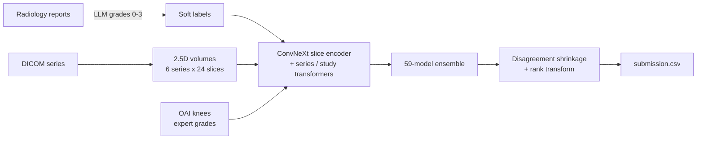

# RSNA Knee MRI 2026 - 102nd place solution


My code for the [RSNA Knee Abnormality Detection](https://www.kaggle.com/competitions/rsna-knee-abnormality-detection)
competition on Kaggle. The task was to read a knee MRI study and give a probability for 12 findings, scored by mean
AUC across the 12 columns.

I finished **102nd of 6,299** (silver), **0.948 private / 0.961 public**, with a 59-model ensemble trained on labels
pulled out of the radiology reports by an LLM. No images were hand-labelled.

I'm a medical student planning to go into radiology, so this was a chance to work on the kind of
images I'll be reading for a living.

---

## Contents

- [The short version](#the-short-version)
- [Labels](#labels)
- [Model](#model)
- [Training](#training)
- [Ensemble and post-processing](#ensemble-and-post-processing)
- [How the score moved](#how-the-score-moved)
- [What the top teams did that I didn't](#what-the-top-teams-did-that-i-didnt)
- [Running the code](#running-the-code)
- [Repo layout](#repo-layout)
- [Credits](#credits)

## The short version



- **Labels come from the reports, not from people.** An LLM read each report and graded every finding.
- **2.5D ConvNeXt** on each slice, then transformers over slices and series.
- **Synovitis was the odd one out.** It ranks best after less than one epoch of training, so it gets its own
  early-checkpoint models. That was the biggest single gain (+0.036 AUC on that column).
- **59 models, weighted by hand**, then pulled toward 0.5 wherever the models disagree.

The 12 findings: ACL, MCL, medial meniscus, lateral meniscus, medial OA, lateral OA, patellofemoral (PF) OA,
effusion, synovitis, Baker's cyst, contusion, fracture.

## Labels

Most training studies come with a radiology report but no per-finding labels, so the first job was turning
reports into targets.

An LLM read each report (text only, no images) and graded each finding 0 to 3, or -1 if the report didn't mention
it. Those grades map to fixed soft targets:

| Report grade | -1 (not mentioned) | 0 | 1 | 2 | 3 |
|---|---|---|---|---|---|
| Target | 0.10 | 0.05 | 0.35 | 0.70 | 0.95 |

I picked these numbers by hand and never fitted them to the 58 expert-labelled studies. That kept those 58 clean as
an evaluation set: they were never trained on and sit outside every fold.

A second LLM pass gave probabilities directly for four of the harder columns (synovitis, contusion, fracture, PF OA).
20 of the 59 final models use it.

On top of the 4,407 competition studies I added 5,239 knees from the
[Osteoarthritis Initiative](https://nda.nih.gov/oai), co-trained on their expert grades where OAI covers the finding.

## Model

`src/model.py`

- **Input:** up to 6 series per study, picked round-robin over plane (sagittal / coronal / axial) and fluid-sensitive
  or not. 24 slices per series at 384 x 384, whole field of view, windowed to the 1st-99th intensity percentile.
  Each slice goes in with its two neighbours as the 3 channels. Right knees are flipped so medial is always on the
  same side.
- **Slice encoder:** ConvNeXt-Tiny or ConvNeXt-Small from timm, ImageNet pretrained.
- **Series:** a 2-layer transformer over the 24 slice tokens, then gated attention pooling.
- **Study:** a second 2-layer transformer over the series tokens, with 12 learned finding queries that
  cross-attend to them, one sigmoid each.
- Some members swap the study transformer for an evidence-MIL head, and 5 are a CoAtNet-rmlp-2 built on a public
  notebook design (see [Credits](#credits)).

## Training

`src/train.py`

- Soft BCE over the 12 columns, plus a small per-series auxiliary loss.
- AdamW (weight decay 0.02), OneCycle with 10% warmup, gradient clipping at 1.0, fp16.
- Effective batch of 8 studies (1 per step, 8 accumulated). EMA 0.999, and the EMA weights are what get served.
- Augmentation: slice-index jitter, a per-series affine (up to 10 degrees, scale 0.92-1.08, shift up to 4%), light
  intensity jitter.
- 5 folds, grouped by near-duplicate report text (MinHash, Jaccard 0.8), so near-identical reports can't end up on
  both sides of a split.

The final 59: 39 ConvNeXt-Tiny, 15 ConvNeXt-Small, 5 CoAtNet. 30 of them come from six full 5-fold families, 14 are
all-data runs, and the rest are single-fold runs.

## Ensemble and post-processing

`notebooks/inference_final_v166.ipynb` is the notebook exactly as submitted (Kaggle, 2 x T4, offline, fp16).

1. Weighted mean of member probabilities. Weights are set by hand in blocks, per column
   (`ensemble/model_weights.json`).
2. Shrink toward 0.5 where members disagree:

   ```
   P' = 0.5 + (P - 0.5) * exp(-4 * MAD)
   ```

   where MAD is the weighted mean absolute deviation of the members from their mean. If the models agree the
   score barely moves; if they split, it gets pulled toward 0.5.
3. A few small frozen per-column shifts from auxiliary heads.
4. Rank transform per column, since the metric only cares about ordering.

### Synovitis

Synovitis AUC peaks around epoch 0-1 and then falls off as training goes on. So that column is served
only from 3 early snapshots plus 5 models with a wider intensity window, and every other model gets weight 0 there.
The early snapshots gave +0.036 column AUC and the wider-window models another +0.012.

## How the score moved

| Date | Public LB | What changed |
|---|---|---|
| 6 Aug | 0.919 | first submission: report labels + ConvNeXt-Tiny slice/series transformer |
| 4 Sep | 0.953 | bigger ensembles, and mainly the synovitis early-checkpoint trick |
| 28 Sep | 0.957 | more members, post-processing |
| 18 Oct | 0.961 | mostly recombining models I already had |

Private came in 0.0148 below public on average across my 171 scored submissions (SD 0.0024). It was close to a
fixed offset, and my best eight submissions all landed between 0.946 and 0.948 private, so the final pick didn't
cost me much.

## What the top teams did that I didn't

The top six finished at 0.958-0.960 private. Reading their write-ups, two ideas stood out.

**Labels from a model that can see the images.** The 1st and 2nd place teams had an LLM look at the slices as well
as the report before giving a probability. 2nd place reports label agreement with experts on the 58 gold studies
going from 0.899 (report only) to 0.942 (report plus every slice).
([1st](https://www.kaggle.com/competitions/rsna-knee-abnormality-detection/writeups/1st-place-solution),
[2nd](https://www.kaggle.com/competitions/rsna-knee-abnormality-detection/writeups/2nd-place-gold-solution-vision-llm-soft-labels-an),
[6th](https://www.kaggle.com/competitions/rsna-knee-abnormality-detection/writeups/6th-place-solution-knee-frame-tiles-pseudo-label))

**Anatomical crops added next to the full view.** 5th place added four joint crops as extra series and went from
0.954 to 0.957 private.
([5th](https://www.kaggle.com/competitions/rsna-knee-abnormality-detection/writeups/5th-place-solution))

I tried both, but in weaker forms. My vision model read the images *without* the report, and only Baker's cyst
cleared the bar I'd set. My crops *replaced* the full view instead of sitting beside it, and scored worse on one
fold. I dropped both on small, single-seed pilots. With a 58-study gold set the noise was about 0.006, which is
bigger than most of the differences I was trying to measure.

If I did it again: test a label source as labels for training, not as a standalone reader; run a baseline
next to every pilot; and build a bigger gold set early.

## Running the code

This is the code as it was used, not a cleaned-up library. You can train and run inference with it, but rebuilding
the exact 59-model package would need per-member flags and label files that aren't in this repo.

```bash
pip install -r requirements.txt          # versions weren't recorded, pin to your own setup
export RSNA_ROOT=/path/to/rsna           # competition data from Kaggle goes under here

bash scripts/slurm_preprocess.sh         # DICOM -> windowed, resized volumes
bash scripts/slurm_train.sh              # base training recipe (one fold)
bash scripts/slurm_export_oof.sh         # out-of-fold predictions
```

The scripts are SLURM examples; adjust the partition, modules and paths for your cluster. `RSNA_QWEN_DIR` is only
needed for the optional Qwen backbone in `src/qwenvit.py`.

For inference on Kaggle, upload your checkpoints as datasets, replace `YOUR_KAGGLE_USERNAME` in the notebook, attach
the datasets and run it offline.

Not included: competition data, labels, model weights, and the LLM label-extraction scripts. Some source comments
point to internal experiment folders that aren't part of this release.

## Repo layout

```
.
├── src/
│   ├── preprocess.py           DICOM -> volumes
│   ├── data.py                 dataset, label loading, soft targets
│   ├── model.py                slice encoder + series/study transformers
│   ├── train.py                training entry point
│   ├── export_oof.py           out-of-fold predictions
│   ├── oof_stacker.py          OOF stacking
│   ├── build_model_weights.py  per-column ensemble weights
│   ├── infer.py                local inference
│   └── ...                     heads, losses, optimiser, checkpoint tools
├── scripts/                    SLURM examples
├── ensemble/
│   ├── final_members.txt       the 59 members
│   └── model_weights.json      per-column weights
└── notebooks/
    └── inference_final_v166.ipynb   Kaggle inference notebook, as submitted
```

## Credits

- The CoAtNet members follow the design of a public Kaggle notebook by **nartaa**, which builds on
  **dreaddevelopment**'s Raptor CoAtNet/MIL recipe. I trained those members myself from timm ImageNet weights on my
  own labels and folds.
- Backbones from [timm](https://github.com/huggingface/pytorch-image-models) and torchvision.
- Training ran on the Monash M3 HPC cluster.
- OAI data is used under the OAI data-use terms and is not redistributed here.
- Thanks to RSNA and Kaggle for running the competition, and to the top teams for writing up their solutions.

## License

MIT, see [LICENSE](LICENSE). Model backbones and third-party designs keep their own licences.
